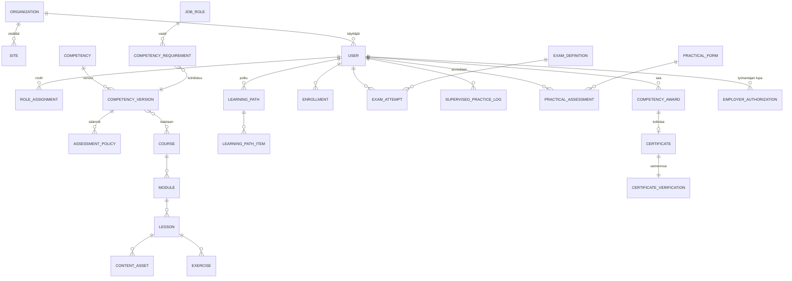

# Hoiwa MedSafe — tuote- ja toteutussuunnitelma

Versio 0.1 (luonnos) · 2026-10-07 · Laatija: tuotesuunnittelu (Claude Code) · Tila: **sisäinen luonnos, ei hyväksytty**

Tämä dokumentti on toteutuksen lähtökohta suunnittelijoille ja ohjelmistokehittäjille. Se kuvaa
Hoiwa MedSafe -alustan toiminnallisuuden, tietomallin, vaiheistuksen ja hyväksymiskriteerit.

> **Dokumentin tärkein pelisääntö:** osaamisen varmistaminen on kliinisesti ja juridisesti
> vastuullista toimintaa. Tässä dokumentissa **ei** väitetä mitään viranomaisvaatimuksista,
> akkreditoinneista, tutkinnonanto-oikeuksista tai kumppanisopimuksista. Kaikki sellaiset kohdat on
> merkitty vahvistettaviksi.

## Merkinnät

| Merkintä | Tarkoitus |
| --- | --- |
| **[V]** | Vahvistettu lähtötieto — annettu toimeksiannossa. |
| **[E]** | Suunnitteluehdotus — tämän dokumentin tekemä ratkaisuesitys, jonka tuoteomistaja voi muuttaa. |
| **[T]** | Vahvistettava / tarkastettava ennen toteutusta — kliininen, pedagoginen, kaupallinen tai maakohtainen päätös. Ei saa koodata oletuksena lukkoon. |
| **[OL]** | Oletus, jota käytetään suunnittelun jatkamiseksi tiedon puuttuessa. Merkitään aina näkyviin. |

Sääntö kehitykseen: **[T]**-kohdat eivät saa päätyä koodiin kovakoodattuina vakioina. Ne ovat
konfiguraatiota (maa-/organisaatiokohtainen arviointimalli), jonka hyväksytty arvo tulee tietokannasta.

---

## 0. Suunnittelun lähtötiedot

| Lähtötieto | Arvo suunnittelussa | Tila |
| --- | --- | --- |
| Kohdemaat | Malesia ja Indonesia (ensimmäiset) | **[V]** |
| Asiakasorganisaation tyypit | Sairaalat, klinikat, kotihoitoyritykset, hoivakodit, henkilöstöpalveluyritykset, terveydenhuollon oppilaitokset | **[V]** |
| Oppijaryhmät | Sairaanhoitajat, hoitoalan opiskelijat, caregivers / avustava hoitohenkilöstö | **[V]** |
| Ensimmäinen koulutuskokonaisuus | Lääkehoidon turvallisuus | **[V]** |
| Kielet | Englanti (ensisijainen julkaisukieli), bahasa Melayu, bahasa Indonesia | **[V]** / julkaisujärjestys **[E]** |
| Pilottiorganisaation koko | 150–600 oppijaa, 1–5 toimipistettä | **[OL]** — mitoitusoletus suorituskyvylle ja hinnoittelumallille |
| Sisältökumppani | Metropolia Ammattikorkeakoulu — yhteistyöaikomus | **[V]** aikomus · laajuus, sisältöjen omistajuus ja hyväksyntäoikeus **[T]** |
| Sertifikaatin myöntäjä | Ei päätetty | **[T]** — ks. §11 |
| Integraatiot | Hoiwa, AerWork, asiakkaan HR-/työvuorojärjestelmä | **[V]** aikomus · rajapinnat ja tietosisältö **[T]** |
| Paikallinen tietosuoja ja sääntely | Malesia (PDPA-tyyppinen sääntely) ja Indonesia (PDP-sääntely) — **selvitettävä paikallisen juristin kanssa** | **[T]** |

Tekninen mitoitusoletus **[OL]**: alusta rakennetaan monitenanttisena SaaS-palveluna, jossa
yksi tenantti = yksi asiakasorganisaatio, ja kaikki oppijadata on tenanttikohtaisesti eristettyä.

---

## 1. Tiivis tuotekuvaus ja asiakashyöty

### 1.1 Tuotekuvaus

Hoiwa MedSafe on terveydenhuollon organisaatioille myytävä B2B SaaS -alusta, joka muuttaa
koulutuksen **todennetuksi ja mitattavaksi kliiniseksi osaamiseksi**. Alusta ei ole kurssikirjasto
eikä perinteinen LMS: sen ydin on **osaamisrekisteri**, johon jokainen suoritus, arviointi ja
hyväksyntä kiinnittyy.

Toimintamalli ammentaa suomalaisesta lääkehoidon osaamisen varmistamisen käytännöstä, jossa
osaamista ei todeta pelkällä koulutukseen osallistumisella, vaan ammattilainen koulutetaan,
testataan, arvioidaan käytännössä, dokumentoidaan ja osaaminen uusitaan säännöllisesti.

Alustan toimintalogiikka yhdellä rivillä:

> Osaamiskartoitus → henkilökohtainen oppimispolku → teoriaopinnot → harjoittelu → teoriakoe →
> lääkelaskukoe → käytännön näyttö → hyväksyntä → sertifikaatti → seuranta ja uusiminen.

### 1.2 Ratkaistava ongelma

| Asiakkaan ongelma | Nykytila ilman MedSafea | MedSafen vastaus |
| --- | --- | --- |
| Ei tiedetä, kuka tosiasiassa osaa | Koulutuslistat ja osallistumistodistukset Excelissä | Osaamismatriisi, joka näyttää osaamisen tilan vaatimuskohtaisesti |
| Osaaminen vanhenee huomaamatta | Manuaalinen seuranta, muistin varassa | Voimassaolo, automaattinen vanhenemisvaroitus ja uusimispolku |
| Käytännön osaamista ei dokumentoida | Suullinen perehdytys, allekirjoitettu paperi | Rakenteinen näyttöarviointi: kriteerit, arvioija, perusteltu päätös |
| Auditointi työllistää | Dokumentit haetaan kansioista | Ladattavat auditointiraportit versiotiedoilla |
| Henkilöstön osaamistaso vaihtelee | Yksikkökohtaiset erot | Yhteinen osaamisviitekehys ja hyväksymiskriteerit |
| Rekrytoinnissa osaaminen on epäselvä | CV ja luottamus | Varmennettava osaamispassi |

### 1.3 Asiakashyöty ostajan kielellä

Yhdestä näkymästä organisaatio näkee:

- kuka on pätevä tiettyyn kliiniseen tehtävään — ja minkä vaatimuksen perusteella
- mitkä osaamiset puuttuvat, keneltä ja mistä yksiköstä
- kenen osaaminen vanhenee seuraavan 30 / 60 / 90 päivän aikana
- mitkä koulutustoimenpiteet pitää käynnistää tällä viikolla
- auditointia varten todennettavan dokumentaation ilman erillistä keruutyötä.

Vaikutusväittämät, jotka pilotissa pitää **mitata, ei markkinoida ennakkoon** **[T]**:
lääkityspoikkeamien tunnistamisen paraneminen, perehdytysajan lyhentyminen, auditointiin
käytetty työaika, osaamisen kattavuus (% vaatimuksista voimassa).

### 1.4 Rajaukset, jotka tuotteen pitää sanoa ääneen

Nämä näkyvät myös tuotteen käyttöliittymässä ja sertifikaateissa:

1. MedSafe-sertifikaatti on **koulutus- ja osaamistodennus**, ei ammatinharjoittamislupa.
2. MedSafe ei myönnä työnantajan tehtäväkohtaista lääkehoitolupaa; se on erillinen hyväksyntä,
   jonka organisaatio tekee omassa prosessissaan (alusta tukee sen kirjaamista, §7.2).
3. Alusta ei anna potilaskohtaisia hoitopäätöksiä eikä korvaa kliinistä harkintaa.
4. Harjoituksissa ja tapauksissa käytetään vain kuvitteellisia potilastietoja.
5. Sisältöjen kliininen oikeellisuus perustuu nimetyn asiantuntijan tarkastukseen **[T]**.

---

## 2. Käyttäjäroolit ja käyttöoikeudet

### 2.1 Suunnitteluperiaate

Kriittinen erottelu, joka toteutetaan oikeustasolla: **sisällön tuottaminen ≠ kliinisen sisällön
hyväksyminen**, ja **opettaminen ≠ käytännön näytön hyväksyminen**. Sama henkilö voi käytännössä
saada useita rooleja, mutta oikeudet ovat erillisiä ja ne myönnetään erikseen.

Lisäksi: **arvioija ei voi hyväksyä omaa näyttöään** eikä sisällön kirjoittaja voi yksin julkaista
omaa kliinistä sisältöään (neljän silmän periaate) **[E]**.

### 2.2 Roolit

| Rooli | Tehtävä alustalla | Näkee | Ei saa |
| --- | --- | --- | --- |
| **Oppija** (Learner) | Opiskelee, harjoittelee, suorittaa kokeet, osallistuu näyttöön, näkee sertifikaattinsa | Oman polkunsa, omat tulokset, oma osaamispassi | Nähdä muiden tuloksia; nähdä koekysymyspankkia; muuttaa omia arviointituloksiaan |
| **Kouluttaja** (Trainer) | Kurssien toimitus, oppimateriaalien liittäminen, oppijoiden ohjaus, harjoituspalaute | Ryhmänsä oppijoiden edistymisen ja harjoitustulokset | Hyväksyä käytännön näyttöä ilman arvioijaroolia; julkaista kliinistä sisältöä ilman tarkastajaa |
| **Käytännön arvioija** (Practical assessor) | Suorittaa ja dokumentoi näyttöarvioinnit, tekee perustellun päätöksen | Osoitetut arvioitavat oppijat, arviointilomakkeet, oma arviointihistoria | Arvioida itseään; muuttaa kriteeristöä; muuttaa jo lukittua arviointia (vain korjausmerkintä) |
| **Esihenkilö** (Supervisor) | Tiimin osaamistilanne, puuttuvien suoritusten seuranta, koulutustoimenpiteet | Oman tiimin/toimipisteen osaamismatriisi, vanhenemiset, raportit | Nähdä yksittäisiä koevastauksia **[E]** (vain tulos ja tila); muuttaa arviointeja |
| **Organisaation pääkäyttäjä** (Org admin) | Käyttäjät, roolit, tehtäväkohtaiset osaamisvaatimukset, arviointimallin valinta, raportointi, asetukset | Koko organisaation data | Muuttaa sisältöjen kliinistä sisältöä; myöntää sertifikaattia ilman täyttyneitä vaatimuksia |
| **Sisältökumppani** (Content author) | Sisältöjen tuottaminen, päivittäminen, käännösten valmistelu | Oman sisältötilansa, luonnokset, versiohistoria | Julkaista kliinistä sisältöä tai koekysymyksiä ilman kliinistä tarkastajaa |
| **Kliininen tarkastaja** (Clinical reviewer) **[E] uusi rooli** | Hyväksyy kliinisen sisällön, koekysymykset ja arviointikriteerit julkaisuun | Tarkastusjonon, lähteet, versioerot | Kirjoittaa ja hyväksyä samaa versiota yksin **[E]** |
| **Hoiwan alustan ylläpitäjä** (Platform admin) | Asiakasorganisaatiot, lisenssit, tukitapaukset, julkaistut sisältöpaketit | Tenanttien hallintatiedot, tekninen loki | Lukea oppijan arviointisisältöjä ilman kirjattua tukitarvetta ja aikarajattua pääsyä **[E]** |

> **[E]** Lisäsin seitsemän annetun roolin rinnalle erillisen **kliinisen tarkastajan**, koska
> toimeksianto vaatii eron sisällön tuottamisen ja kliinisen hyväksynnän välille. Ilman omaa roolia
> tätä eroa ei voi valvoa teknisesti.

### 2.3 Oikeusmatriisi (ote)

L = luku, K = kirjoitus/luonnos, H = hyväksyntä, — = ei oikeutta

| Toiminto | Oppija | Kouluttaja | Arvioija | Esihenkilö | Org admin | Sisältökumppani | Kliin. tarkastaja | Platform admin |
| --- | --- | --- | --- | --- | --- | --- | --- | --- |
| Oma oppimispolku | L | L | — | L (tiimi) | L | — | — | — |
| Kurssisisällön luonti | — | K (ei-kliininen) | — | — | — | K | L | — |
| Kliinisen sisällön julkaisu | — | — | — | — | — | — | **H** | — |
| Koekysymyspankki | — | L (omat harjoitukset) | — | — | — | K | **H** | — |
| Teoriakokeen tulos | L (oma) | L | — | L (vain tila/tulos) | L | — | — | — |
| Ohjatun harjoittelun kirjaus | L | **K** | K | L | L | — | — | — |
| Käytännön näytön arviointi | L (oma) | — | **K + H** | L (tila) | L | — | — | — |
| Osaamisen hyväksyntä (award) | — | — | H (näytön osalta) | — | H (kokonaisuus) | — | — | — |
| Sertifikaatin peruutus | — | — | — | — | **H** | — | — | H (tuki, kirjattu syy) |
| Osaamisvaatimusten määrittely | — | — | — | Ehdotus | **K + H** | — | L | — |
| Arviointimallin (rajat, voimassaolo) valinta | — | — | — | — | **H** | — | L | K (maapohja) |
| Aiemman osaamisen hyväksiluku | Hakemus | Ehdotus | — | Ehdotus | **H** | — | — | — |
| Auditointiraportit | — | L (rajattu) | — | L (tiimi) | L | — | — | L (tenanttitaso) |

### 2.4 Tekninen toteutus

- Rooli sidotaan **organisaatioon ja laajuuteen** (organisaatio / toimipiste / tiimi), ei pelkkään
  käyttäjään: `role_assignment(user, role, scope_type, scope_id, valid_from, valid_to)`.
- Arvioijalla on lisäksi **pätevyysehto**: `assessor_qualification(user, competency_id, verified_by, valid_to)`.
  Alusta estää arvioinnin, jos arvioijan pätevyys ei kata arvioitavaa osaamista **[E]**.
- Kaikki oikeustarkistukset tehdään palvelinpuolella (rivitason käyttöoikeudet tietokannassa),
  ei käyttöliittymässä.
- Jokainen oikeuksien muutos ja jokainen pääsy arviointidataan kirjautuu lokiin (Liite C.3).

---

## 3. Oppijan koko oppimis- ja arviointipolku

### 3.1 Polku vaiheittain

| # | Vaihe | Mitä tapahtuu | Kirjautuu järjestelmään | Portti seuraavaan |
| --- | --- | --- | --- | --- |
| 1 | **Kutsu ja tunnistautuminen** | Organisaatio lisää oppijan (tai HR-integraatio tuo), oppija aktivoi tunnuksen | Käyttäjä, rooli, toimipiste, kieli | Hyväksytty käyttöehto ja tietosuojailmoitus |
| 2 | **Osaamiskartoitus** | Itsearvio + diagnostinen testi + aiemman osaamisen ilmoitus | `competency_assessment_intake` | Kartoitus valmis |
| 3 | **Aiemman osaamisen hyväksiluku** (jos haetaan) | Oppija liittää dokumentit, valtuutettu henkilö hyväksyy/hylkää perustellen | `prior_learning_claim` + päätös | Vain hyväksytty hyväksiluku ohittaa osion |
| 4 | **Henkilökohtainen oppimispolku** | Järjestelmä muodostaa polun: puuttuvat osaamiset → kurssit → kokeet → näyttö | `learning_path` + `learning_path_item` | Polku aktivoitu |
| 5 | **Teoriaopinnot** | Moduulit, oppitunnit, materiaalit, oppituntikohtaiset harjoituskysymykset | `lesson_progress` | Moduulien vähimmäisedistymä (oletus 100 % pakollisista oppitunneista) **[E]** |
| 6 | **Digitaaliset harjoitukset ja simulaatiot** | Potilastapaukset, lääkelaskuharjoitukset, selittävä palaute, rajaton uusinta | `exercise_attempt` | Harjoituskynnys (esim. 1 läpäisty harjoitussarja) **[E]** |
| 7 | **Teoriakoe** | Satunnaistettu koe kysymyspankista, aikaraja, yrityskerrat | `exam_attempt` + aihealuetulokset | Hyväksymisraja arviointimallista **[T]** |
| 8 | **Lääkelaskukoe** | Erillinen koe, yksikkö- ja tarkkuusvalidointi, laskutilan näyttö | `exam_attempt` (tyyppi: calculation) | Hyväksymisraja arviointimallista **[T]** |
| 9 | **Ohjattu harjoittelu** | Työpaikalla/oppilaitoksessa, ohjaaja kirjaa taidot ja palautteen | `supervised_practice_log` | Vaadittu määrä kirjauksia osaamiskohtaisesti **[E]** |
| 10 | **Käytännön osaamisnäyttö** | Arvioija käyttää ennalta määriteltyä lomaketta, kriteerikohtainen tulos | `practical_assessment` + `criterion_result` | Ei kriittisiä puutteita + kriteerien vähimmäistaso |
| 11 | **Hyväksyntä** | Järjestelmä tarkistaa kaikki vaatimukset; valtuutettu henkilö hyväksyy | `competency_award` (tila: valid) | Kaikki pakolliset osiot läpi |
| 12 | **Sertifikaatti** | Myönnetään automaattisesti hyväksynnän jälkeen, QR-varmennus | `certificate` + `verification_token` | — |
| 13 | **Osaamispassi** | Sertifikaatit ja voimassaolot koottuna, jaettavissa | näkymä | — |
| 14 | **Seuranta** | Vanhenemisvaroitukset 90/60/30 pv **[E]**, esihenkilölle ja oppijalle | `notification` | — |
| 15 | **Uusiminen** | Kevyempi uusimispolku (päivityskurssi + koe + tarvittaessa näyttö) | uusi `competency_award` versio | Arviointimallin uusimissääntö **[T]** |

### 3.2 Poikkeamapolut

| Tilanne | Käsittely |
| --- | --- |
| Koe hylätty | Palaute aihealueittain → järjestelmä ehdottaa kohdennettua lisäopiskelua → uusintakoe odotusajan jälkeen (oletus 24 h) **[E]**; yrityskertojen enimmäismäärän jälkeen pakollinen kouluttajakontakti |
| Koe keskeytyi (verkko, laite) | Suoritus palautetaan samaan tilaan aikaleimojen perusteella; jäljellä oleva aika säilyy; keskeytys merkitään lokiin (ks. Liite C.2) |
| Näyttö hylätty | Arvioija kirjaa kehittämiskohteet → järjestelmä luo lisäharjoittelujakson → uusinta-arviointi, oletuksena eri arvioija jos toinen hylkäys **[E]** |
| Kriittinen puute näytössä | Hyväksyminen estetään automaattisesti arviointimallin mukaisesti; kirjataan perustelu |
| Oppija siirtyy organisaation sisällä | Osaamiset seuraavat; tehtäväkohtaiset vaatimukset lasketaan uudelleen uuden tehtävän mukaan |
| Oppija poistuu organisaatiosta | Oppijan tunnus deaktivoidaan; henkilökohtainen osaamispassi säilyy oppijan omana tietona sovitun säilytysajan mukaan **[T]** |
| Sisältö päivittyy kesken polun | Oppija jatkaa aloitetulla sisältöversiolla, ellei muutos ole merkitty kliinisesti kriittiseksi — silloin pakotettu siirtymä uuteen versioon **[E]** |

### 3.3 Mitä polku ei salli

- Digitaalisen kurssin suorittaminen **ei** korvaa vaadittua käytännön näyttöä.
- Sertifikaattia **ei** voi myöntää ennen kuin kaikki pakolliset vaatimukset ovat täytetty
  (järjestelmätasoinen esto, ei vain käyttöliittymän varoitus).
- Tekoäly **ei** hyväksy mitään osiota.

---

## 4. Moduulit ja toiminnallisuudet

Vaihe: **MVP** = ensimmäinen myytävä versio · **V2** = seuraava kehitysvaihe · **V3** = pitkän aikavälin laajennus

| # | Moduuli | Keskeiset toiminnot | Pääroolit | Vaihe |
| --- | --- | --- | --- | --- |
| M1 | **Organisaatio- ja käyttäjähallinta** | Tenantit, toimipisteet, tiimit, käyttäjien luonti ja kutsut, roolit laajuuksittain, massatuonti (CSV), deaktivointi | Org admin, Platform admin | MVP |
| M2 | **Osaamisrekisteri** | Osaamisten määrittely (kentät §7.2 `competency_version`), versiointi, esitiedot, tehtäväkohtaiset vaatimukset, maa-/organisaatiovariantit | Org admin, Kliin. tarkastaja | MVP |
| M3 | **Osaamiskartoitus ja oppimispolku** | Itsearvio, diagnostinen testi, aiemman osaamisen hyväksilukuhakemus ja päätös, polun automaattinen muodostus ja uudelleenlaskenta | Oppija, Org admin, Kouluttaja | MVP |
| M4 | **Sisältöstudio ja versionhallinta** | Luonnos → tarkastus → julkaisu -työnkulku, lähdeviitteet, vastuuhenkilö, tarkastuspäivä ja seuraava tarkastus, versioerot, arkistointi | Sisältökumppani, Kliin. tarkastaja | MVP |
| M5 | **Oppimisnäkymä (course player)** | Kokonaisuus→kurssi→moduuli→oppitunti-rakenne, edistymän tallennus, jatka-mistä-jäit, materiaalien esitys, tekstitykset | Oppija | MVP |
| M6 | **Harjoituspankki ja simulaatiot** | Harjoituskysymykset, interaktiiviset potilastapaukset (kuvitteelliset tiedot), selittävä palaute, rajaton uusinta, erillään koekysymyksistä | Oppija, Kouluttaja | MVP (tapaussimulaatiot kevyinä), V2 (haarautuvat tapaukset) |
| M7 | **Teoriakoemoottori** | Kysymyspankki osaamistavoitteisiin sidottuna, koeblueprint (aihe- ja vaikeuskattavuus), satunnaistus, kysymystyypit, aikaraja, yrityskerrat, keskeytyksen käsittely, aihealuetulokset, uusinta ja oikaisu | Oppija, Kouluttaja, Org admin | MVP |
| M8 | **Lääkelaskumoottori** | Numeerinen vastaus, yksiköt, pyöristys- ja toleranssisäännöt, välivaiheiden näyttö, laskutyyppikirjasto (annos, laimennus, infuusionopeus, painoperusteinen annos), erillinen hyväksymisraja | Oppija, Kliin. tarkastaja | MVP |
| M9 | **Ohjatun harjoittelun kirjaus** | Taitokirjaus (taito, pvm, ohjaaja, palaute), mobiilikirjaus, allekirjoitus/vahvistus, vaaditun määrän seuranta | Kouluttaja, Arvioija, Oppija | MVP |
| M10 | **Käytännön näytön arviointi** | Arviointilomake kriteereittäin, kriittiset kriteerit, arvioijan tunniste, aika ja paikka, perusteltu päätös, offline-kirjaus ja synkronointi, lukitus ja korjausmerkintä | Arvioija | MVP |
| M11 | **Hyväksyntä- ja sertifikaattimoottori** | Vaatimusten täyttymisen tarkistus, hyväksyntä, sertifikaatin generointi (PDF + tietue), voimassaolo, uusiminen, korjaus, peruutus | Org admin, Arvioija | MVP |
| M12 | **Osaamispassi ja julkinen varmennus** | Oppijan passi, jakolinkki, QR-koodi, julkinen varmennussivu vähimmäistiedoin, peruutettujen tunnistus | Oppija, ulkoinen tarkistaja | MVP |
| M13 | **Osaamismatriisi ja raportointi** | Tilamatriisi (6 tilaa), suodatus tehtävän/tiimin/toimipisteen mukaan, puuttuvat suoritukset, vanhenemiset, auditointiraportti (PDF/CSV) versiotiedoin | Esihenkilö, Org admin | MVP |
| M14 | **Muistutukset ja uusimisautomaatio** | 90/60/30 pv muistutukset **[E]**, erääntyneet, sähköposti + sovellusilmoitus, esihenkilön koontiviesti, uusimispolun automaattinen avaus | Kaikki | MVP (perus), V2 (eskalointisäännöt) |
| M15 | **Integraatiot ja API** | REST-API osaamistiedoille, webhookit (osaaminen myönnetty/vanhenemassa/vanhentunut), Hoiwa/AerWork-liitos, HR-käyttäjien tuonti, SSO | Platform admin, asiakkaan IT | V2 (MVP: CSV-tuonti/-vienti + luettava API) |
| M16 | **Tekoälytutor ja käännöstyökalut** | Hyväksyttyyn sisältöön rajattu opiskelutuki lähdeviittein, harjoituskysymysten luonnostelu tarkastettavaksi, käännösluonnokset | Oppija, Sisältökumppani | V2 (MVP: vain sisäinen luonnostelutyökalu sisällöntuotannossa) |
| M17 | **Lokitus, tietosuoja ja säilytys** | Muuttumaton tapahtumaloki, pääsyloki, säilytysajat, henkilötietojen vienti ja poisto, suostumukset | Org admin, Platform admin | MVP |
| M18 | **Lokalisointi ja monikielisyys** | Käyttöliittymän kielet, sisältöjen kieliversiot ja käännöstila, aikavyöhykkeet, päivämäärä- ja numeroformaatit | Platform admin, Sisältökumppani | MVP (EN + 1 kieli), V2 (kolmas kieli) |
| M19 | **Alustan ylläpito** | Tenanttien luonti, lisenssirajat, sisältöpakettien jakelu tenanteille, tukipääsy aikarajattuna ja kirjattuna | Platform admin | MVP |
| M20 | **Työvuorovaatimusten tarkistus** | Tehtävän/vuoron osaamisvaatimusten vertailu voimassa oleviin osaamisiin, varoitus tai esto organisaation säännön mukaan | Esihenkilö, integraatio | V2 |
| M21 | **Valvottu koe (proctoring)** | Henkilöllisyyden varmistus, valvottu tila, valvojan kirjaus; tarvetaso maakohtainen **[T]** | Oppija, Kouluttaja | V2 |
| M22 | **Oppilaitoskäyttö** | Ryhmät, kurssi-instanssit, lukuvuodet, opettajan arviointinäkymä, opiskelijoiden massahallinta | Oppilaitosasiakkaat | V2 |
| M23 | **Asiakasbrändätty versio** | Logo, värit, oma verkkotunnus, sertifikaatin ulkoasu | Org admin | V3 |

---

## 5. Keskeiset käyttöliittymänäkymät

Suunnitteluperiaatteet **[E]**: mobiili ensin (hoitotyön arki on puhelimella), suuret kosketusalueet,
vähän tekstiä per näkymä, aina näkyvissä "mitä seuraavaksi", saavutettavuus WCAG 2.2 AA -tavoitteena
**[T]** (tavoitetaso vahvistettava asiakasvaatimusten kanssa).

### 5.1 Oppijan etusivu — "Minun osaamiseni"

Vastaa neljään kysymykseen yhdellä silmäyksellä:

```
┌─────────────────────────────────────────────┐
│ Hei, Siti.           [kielivalinta] [profiili]│
├─────────────────────────────────────────────┤
│ SEURAAVA VAIHE                              │
│ ▸ Lääkelaskukoe — valmiina suoritettavaksi  │
│   Arvioitu kesto 30 min · Yritys 1/3        │
│   [Aloita]                                   │
├─────────────────────────────────────────────┤
│ POLKUNI: Lääkehoidon turvallisuus (perus)   │
│ ●──●──●──◐──○──○                            │
│ Teoria  Harj.  Koe  Laskut  Näyttö  Sertif. │
│ 4/6 vaihetta valmiina                        │
├─────────────────────────────────────────────┤
│ ODOTTAA MINUA                                │
│ · Ohjattu harjoittelu: 2/4 kirjausta         │
│ · Näyttöaika sovittava esihenkilön kanssa    │
├─────────────────────────────────────────────┤
│ VOIMASSA OLEVA OSAAMISENI            (3)     │
│ ✓ Aseptinen työskentely   voimassa 11/2027  │
│ ⚠ Lääkkeiden käsittely    vanhenee 42 pv    │
├─────────────────────────────────────────────┤
│ [Osaamispassini]  [Opiskele]  [Harjoittele] │
└─────────────────────────────────────────────┘
```

Keskeistä: **yksi** ensisijainen toiminto kerrallaan; vanhenemisvaroitus näkyy ennen kuin se on
kiireellinen; offline-tilassa näkyy mitkä osiot ovat käytettävissä ilman verkkoa.

### 5.2 Kurssinäkymä (course player)

- Vasemmalla rakenne: kokonaisuus → kurssi → moduuli → oppitunti, edistymä merkkeinä.
- Keskellä sisältö: teksti, kuva, video tekstityksin, ääni tekstivastineineen, ladattava tarkistuslista.
- Alareunassa: "Oppitunnin harjoituskysymykset (3)" — matalan kynnyksen tarkistus, ei arvosanaa.
- Ylhäällä aina näkyvissä: **sisällön versio ja tarkastuspäivä** (luottamussignaali hoitotyössä).
- "Jatka mistä jäit" palauttaa tarkan kohdan myös laitetta vaihdettaessa.

### 5.3 Koenäkymä

- Ennen koetta: ehdot yhdellä sivulla — aikaraja, yrityskerta, sallitut apuvälineet **[T]**,
  hyväksymisraja, mitä keskeytyksessä tapahtuu, tunnistautumisvaatimus.
- Kokeen aikana: yksi kysymys kerrallaan, jäljellä oleva aika, merkitse-myöhemmin, ei takaisinnavigointia
  jos arviointimalli niin määrää **[T]**.
- Lääkelaskuissa: numerokenttä + erillinen yksikkövalinta, välivaiheiden kirjaus (arvioitavissa
  myöhemmin), ei automaattista pyöristystä oppijan puolesta.
- Verkkokatkos: selkeä ilmoitus "Suorituksesi on tallennettu paikallisesti — aika jatkuu / aika pysäytetty"
  (kumpi, määräytyy arviointimallista **[T]**); palautus samaan kohtaan.
- Kokeen jälkeen: tulos aihealueittain, kohdennettu opiskelusuositus, uusinnan ajankohta, oikaisupyyntö.

### 5.4 Arvioijan näyttölomake (mobiili, offline-kelpoinen)

```
┌─────────────────────────────────────────────┐
│ NÄYTTÖ: Lääkkeen anto p.o. · Siti Rahman    │
│ Lomake v2.1 · Osaaminen MS-MED-100          │
├─────────────────────────────────────────────┤
│ 1. Tunnistaa potilaan ohjeen mukaan  [KRIIT.]│
│    ○ Täyttyy  ○ Ei täyty                     │
│ 2. Tarkistaa lääkemääräyksen                 │
│    ○ Täyttyy  ○ Osittain  ○ Ei täyty        │
│ ...                                          │
│ 9. Kirjaa annon ja poikkeamat                │
├─────────────────────────────────────────────┤
│ Havainnot (pakollinen, jos ei täyty):        │
│ [                                         ]  │
├─────────────────────────────────────────────┤
│ PÄÄTÖS  ○ Hyväksytty  ○ Hylätty             │
│ Perustelu: [                             ]   │
│ Arvioija: R. Tan (pätevyys voimassa 03/2027) │
│ Aika: 2026-11-04 09:40 · Paikka: Ward 3      │
│ [Tallenna luonnos]  [Lukitse ja lähetä]     │
└─────────────────────────────────────────────┘
```

Säännöt: kriittinen kriteeri "ei täyty" → päätös "Hyväksytty" on estetty; perustelu pakollinen;
lukitsemisen jälkeen muutos vain erillisellä korjausmerkinnällä, joka jää näkyviin.

### 5.5 Esihenkilön osaamismatriisi

- Rivit = työntekijät, sarakkeet = osaamisvaatimukset valitussa tehtävässä; solu = tila (6 tilaa, §7.4).
- Suodattimet: toimipiste, tiimi, tehtävä, tila, vanheneminen (30/60/90 pv), kieli.
- Yläpalkin tunnusluvut: vaatimusten kattavuus %, arviointia odottavat, vanhenevat, erääntyneet.
- Rivin avaus: mitä puuttuu, mikä on seuraava vaihe, [Lähetä muistutus] [Varaa näyttöaika] [Vie raportti].
- **Suunnitteluehto:** näkymä ei koskaan näytä leimaa "työkelpoinen" / "ei työkelpoinen". Se näyttää
  vaatimuskohtaisen tilan ja laskee kattavuuden valitun vaatimuslistan mukaan.

### 5.6 Organisaation pääkäyttäjän asetukset

Välilehdet: Käyttäjät · Tehtävät ja osaamisvaatimukset · Arviointimalli · Sisältöpaketit ·
Raportit · Integraatiot · Tietosuoja ja säilytys.

"Arviointimalli" on tuotteen tärkein konfiguraationäkymä: hyväksymisrajat, yrityskerrat, sallitut
apuvälineet, voimassaoloajat, uusimissäännöt, näyttövaatimukset, arvioijan pätevyysehto. Näkymä
näyttää aina **kenen hyväksymä** malli on käytössä ja **milloin** — ja estää julkaisun ilman hyväksyjää.

### 5.7 Sisältöstudio

Luonnos → tarkastuksessa → hyväksytty → julkaistu → arkistoitu. Jokaisessa sisältöyksikössä pakolliset
kentät: vastuuhenkilö, lähteet, tarkastuspäivä, versio, seuraava tarkastusajankohta, kieliversiot.
Tarkastusjono näyttää vanhenevat tarkastukset punaisella. Tekoälyn tuottama luonnos on aina merkitty
ja vaatii tarkastajan hyväksynnän.

### 5.8 Julkinen varmennussivu

Avautuu QR-koodista. Näyttää **vain**: sertifikaatin nimi, varmennetun osaamisen nimi, myöntävä taho,
myöntämispäivä, voimassaolo, tunniste, sisältö- ja arviointiversio, tila (voimassa / vanhentunut /
peruutettu) ja rajaukset. **Ei** näytä syntymäaikaa, työnantajaa, koetuloksia eikä arvioijan nimeä
**[E]** — vain nimi siinä laajuudessa, joka on sovittu oppijan kanssa **[T]**.

---

## 6. Esimerkkikurssin rakenne

### 6.1 Kurssikortti

| Kenttä | Arvo |
| --- | --- |
| Tunniste | `MS-MED-100` |
| Nimi | Lääkehoidon turvallisuus — perustaso |
| Koulutuskokonaisuus | Lääkehoidon turvallisuus **[V]** |
| Kohderyhmä | Sairaanhoitajat ja lääkehoitoon osallistuva hoitohenkilöstö **[E]** |
| Kielet | EN (julkaisu 1), bahasa Melayu / bahasa Indonesia (julkaisu 2) **[E]** |
| Arvioitu kesto | Teoria 6 h, harjoitukset 2 h, ohjattu harjoittelu 4 h, kokeet 1,5 h, näyttö 45 min **[E]** |
| Esitiedot | Voimassa oleva ammatillinen asema organisaatiossa; perehdytys yksikköön **[T]** |
| Arviointitapa | Teoriakoe + lääkelaskukoe + käytännön näyttö |
| Saavutettava osaaminen | `MS-COMP-MED-BASIC` — "Toteuttaa määrätyn lääkehoidon turvallisesti ohjeistuksen mukaan ja tunnistaa poikkeamat" |
| Sisällön tila | **[T] Kliinisen asiantuntijan tarkastettava** — kaikki alla oleva on sisältöehdotus |

### 6.2 Osaamistavoitteet

Oppija osaa kurssin jälkeen:

1. nimetä lääkityspoikkeamien tavallisimmat syntymekanismit ja omat vastuunsa niiden estämisessä
2. varmistaa oikean potilaan, lääkkeen, annoksen, antotavan, ajankohdan ja dokumentoinnin
3. käsitellä ja säilyttää lääkkeitä ohjeistuksen ja aseptiikan mukaisesti
4. laskea virheettömästi tavalliset annos-, laimennus- ja infuusiolaskut
5. dokumentoida annetun lääkehoidon ja sen vaikutukset vaaditulla tavalla
6. tunnistaa poikkeaman, toimia potilasturvallisesti ja tehdä poikkeamailmoituksen.

### 6.3 Moduulit (sisältöehdotus, **[T]**)

| Moduuli | Oppitunnit | Materiaali | Harjoitus |
| --- | --- | --- | --- |
| M1 Lääkehoidon turvallisuuden perusteet | Vastuut ja roolit · Poikkeamien syntymekanismit · Turvallisuuskulttuuri | Teksti + infografiikka + 4 min video | 6 harjoituskysymystä + tapaus "väärä potilas" |
| M2 Lääkkeiden käsittely ja säilytys | Aseptiikka · Säilytysolosuhteet · Jaottelu ja tunnistus · Jätteet ja palautukset | Teksti + kuvasarja + tarkistuslista (PDF) | 8 harjoituskysymystä + kuvatunnistusharjoitus |
| M3 Lääkelaskenta | Yksiköt ja muunnokset · Annoslaskut · Laimennus · Infuusionopeus · Painoperusteinen annos | Teksti + laskettu esimerkki per tyyppi + ääniselostus | 5 harjoitussarjaa × 10 laskua, selittävä palaute |
| M4 Antotavat ja tunnistusvarmistus | Antotavat · Tunnistusvarmistuksen käytännöt · Keskeytysten hallinta | Video + vuokaavio | Interaktiivinen tapaus: keskeytys lääkkeenjaon aikana |
| M5 Dokumentointi ja poikkeamat | Kirjaamisen vaatimukset · Poikkeaman tunnistus · Ilmoitusprosessi · Potilaan informointi | Teksti + esimerkkikirjaukset + lomakemalli | Tapaus: poikkeama havaittu annon jälkeen |

### 6.4 Arvioinnit

**Teoriakoe `MS-MED-100-T1`** (ehdotus, rajat vahvistettava arviointimallissa **[T]**)

| Parametri | Ehdotus **[E]** |
| --- | --- |
| Kysymysmäärä | 40, satunnaistettu blueprintin mukaan |
| Kattavuus | M1 20 % · M2 25 % · M4 25 % · M5 30 % (M3 omana kokeena) |
| Kysymystyypit | Monivalinta, monivalinta useita oikeita, totta/tarua perusteluvalinnalla, järjestäminen, lyhyt vastaus |
| Vaikeustasot | Perus 50 % · soveltava 35 % · tapauspohjainen 15 % |
| Aika | 45 min |
| Yrityskerrat | 3, odotusaika 24 h, kolmannen jälkeen kouluttajakontakti pakollinen |
| Hyväksymisraja | **[T]** — asetetaan hyväksytyssä arviointimallissa; järjestelmän oletuspohja 80 % **[OL]** |

**Lääkelaskukoe `MS-MED-100-C1`**

| Parametri | Ehdotus **[E]** |
| --- | --- |
| Tehtävämäärä | 10, kattaen kaikki M3-laskutyypit |
| Vastaus | Numero + yksikkö; toleranssi ja pyöristyssääntö määritellään tehtävätyypille |
| Apuvälineet | **[T]** — laskin sallittu/ei, kynä ja paperi, aikaraja |
| Hyväksymisraja | **[T]** — lääkelaskennassa raja on tyypillisesti korkeampi kuin teoriakokeessa; arvo tulee arviointimallista, ei koodista |
| Erityissääntö **[E]** | Yksikkövirhe lasketaan virheeksi, ei osittain oikeaksi |

**Käytännön näyttö `MS-MED-100-P1`**

| Kriteeri | Kriittinen? |
| --- | --- |
| 1. Varmistaa potilaan tunnistuksen ohjeen mukaan | **Kyllä** |
| 2. Tarkistaa lääkemääräyksen ja sen voimassaolon | **Kyllä** |
| 3. Noudattaa aseptiikkaa ja käsihygieniaa | **Kyllä** |
| 4. Valmistelee ja annostelee oikein (sis. tarvittava lasku) | **Kyllä** |
| 5. Käyttää oikeaa antotapaa ja ajankohtaa | Kyllä |
| 6. Ohjaa ja informoi potilasta ymmärrettävästi | Ei |
| 7. Seuraa vaikutusta ja tunnistaa poikkeavan reaktion | Kyllä |
| 8. Kirjaa annon vaatimusten mukaisesti | **Kyllä** |
| 9. Toimii oikein poikkeamatilanteessa (simuloitu tai kuvattu) | Kyllä |

Päätössääntö **[E]**: yksikin kriittinen kriteeri "ei täyty" → hylätty. Ei-kriittisissä sallitaan
enintään yksi "osittain", joka kirjataan kehittämiskohteeksi. Arvioijan pätevyyden tulee kattaa
`MS-COMP-MED-BASIC`.

### 6.5 Hyväksyntä ja sertifikaatti

Myöntämisen ehdot (kaikkien täytyttävä, järjestelmä tarkistaa):

- M1–M5 pakolliset oppitunnit suoritettu
- harjoituskynnys täytetty
- `MS-MED-100-T1` hyväksytty voimassa olevalla arviointimallilla
- `MS-MED-100-C1` hyväksytty
- ohjatun harjoittelun kirjaukset vaaditulla määrällä
- `MS-MED-100-P1` hyväksytty, arvioijan pätevyys voimassa arviointihetkellä
- organisaation pääkäyttäjän tai valtuutetun hyväksyntä.

Sertifikaatti: `Medication Safety — Basic Level, verified competence`, voimassaolo arviointimallin
mukaan (järjestelmän oletuspohja 24 kk **[OL]**, **[T]**), QR-varmennus, sisältö- ja arviointiversio
merkittynä, rajaus: *"Verified training competence. Not a licence to practise. Does not replace an
employer's task-specific medication authorisation."*

---

## 7. Tietomallin keskeiset kokonaisuudet

### 7.1 Suunnitteluperiaatteet

1. **Osaaminen on ensiluokkainen käsite**, ei kurssin sivutuote. Kurssi on väline, `competency_award` on tulos.
2. **Kaikki arviointi on versioitua ja muuttumatonta.** Hyväksyttyä arviointitulosta ei päivitetä paikallaan;
   korjaus luo uuden tietueen ja säilyttää alkuperäisen (auditointikelpoisuus).
3. **Jokainen tietue kantaa `organization_id`:n** ja käyttöoikeus tarkistetaan rivitasolla.
4. **Arviointisäännöt ovat dataa, ei koodia** (`assessment_policy`), koska ne ovat maa- ja
   organisaatiokohtaisia **[T]**.
5. **Sisältöversio tallennetaan suoritukseen**, jotta jälkikäteen tiedetään millä sisällöllä ja
   millä kriteereillä osaaminen on todettu.

### 7.2 Kokonaisuudet

**Organisaatio ja käyttäjät**

| Entiteetti | Keskeiset kentät | Suhteet |
| --- | --- | --- |
| `organization` | nimi, maa, tyyppi, kieliasetukset, lisenssitila | 1–N `site`, 1–N `user` |
| `site` | nimi, organisaatio, aikavyöhyke | N–1 `organization`, 1–N `team` |
| `team` | nimi, site, esihenkilö | 1–N `user_membership` |
| `user` | nimi, sähköposti, kieli, tila, ulkoinen HR-tunniste | N–M `role_assignment` |
| `role_assignment` | user, rooli, scope_type (org/site/team), scope_id, valid_from, valid_to | — |
| `assessor_qualification` | user, competency_id, verified_by, valid_from, valid_to, dokumentti | N–1 `competency` |
| `job_role` | nimi (esim. "Ward nurse, medication"), organisaatio | 1–N `competency_requirement` |

**Osaaminen ja vaatimukset**

| Entiteetti | Keskeiset kentät | Suhteet |
| --- | --- | --- |
| `competency` | tunniste, nimi, kuvaus, kohderyhmä, tila | 1–N `competency_version` |
| `competency_version` | versio, osaamistavoite (mitattava), hyväksymiskriteerit, näyttövaatimus (pakollinen/ei), hyväksyjän pätevyysvaatimus, voimassaolo kk, uusimismenettely, esitiedot, julkaisutila, hyväksyjä, hyväksyntäpvm | N–1 `competency`, N–M `course` |
| `competency_prerequisite` | competency_version → vaadittu competency | itseviittaava |
| `competency_requirement` | job_role / task → competency_version, pakollisuus, maa-/organisaatiovariantti | N–1 `job_role` |
| `assessment_policy` | organisaatio, maa, competency_version, hyväksymisrajat, yrityskerrat, apuvälineet, aikarajat, voimassaolo, uusimissääntö, kriittisten kriteerien sääntö, hyväksyjä, voimassa alkaen | **[T]**-arvojen koti |

**Sisältö**

| Entiteetti | Keskeiset kentät | Suhteet |
| --- | --- | --- |
| `program` (koulutuskokonaisuus) | nimi, kuvaus, kohdemarkkina | 1–N `course` |
| `course` | tunniste, nimi, kohderyhmä, kesto, esitiedot, arviointitapa | 1–N `module`, N–M `competency_version` |
| `module` | nimi, järjestys | 1–N `lesson` |
| `lesson` | nimi, tyyppi, järjestys, pakollisuus | 1–N `content_asset`, 1–N `exercise` |
| `content_asset` | tyyppi (teksti/kuva/video/ääni/liite), kieli, URL, tekstitys/tekstivastine, saavutettavuustiedot | N–1 `lesson` |
| `content_version` | versionumero, vastuuhenkilö, lähteet, tarkastuspäivä, tarkastaja, seuraava tarkastus, julkaisutila, kliinisesti kriittinen -lippu | N–1 (course/module/lesson/asset) |
| `content_review` | reviewer, päätös, kommentit, aikaleima | N–1 `content_version` |
| `translation` | content_version, kieli, tila (luonnos/tarkastettu/julkaistu), kääntäjä, tarkastaja | N–1 `content_version` |

**Oppiminen ja harjoittelu**

| Entiteetti | Keskeiset kentät | Suhteet |
| --- | --- | --- |
| `intake_assessment` | user, itsearvio, diagnostinen tulos, aikaleima | 1–1 `learning_path` |
| `prior_learning_claim` | user, competency_version, dokumentit, päätös, päättäjä, perustelu, aikaleima | N–1 `user` |
| `learning_path` | user, competency-tavoitteet, tila, luontiperuste | 1–N `learning_path_item` |
| `learning_path_item` | tyyppi (course/exam/practice/practical), kohde, järjestys, tila, määräpäivä | — |
| `enrollment` | user, course, course_content_version, tila, aloitus, valmistuminen | N–1 `course` |
| `lesson_progress` | enrollment, lesson, tila, viimeinen kohta, aika | — |
| `exercise` | lesson, tyyppi, kysymys, oikea vastaus, selittävä palaute | N–1 `lesson` |
| `exercise_attempt` | user, exercise, vastaus, tulos, aikaleima | — |
| `supervised_practice_log` | user, competency_version, taito, pvm, ohjaaja, palaute, vahvistus | N–1 `user` |

**Kokeet**

| Entiteetti | Keskeiset kentät | Suhteet |
| --- | --- | --- |
| `question_bank` | nimi, competency_version, käyttötarkoitus (**harjoitus / koe — erillään**) | 1–N `question` |
| `question` | tyyppi, aihealue, vaikeustaso, osaamistavoite-viite, tila | 1–N `question_version` |
| `question_version` | sisältö, vaihtoehdot, oikea vastaus, palaute, yksikkö/toleranssi (laskut), tarkastaja, hyväksyntäpvm | N–1 `question` |
| `exam_definition` | tunniste, tyyppi (theory/calculation), blueprint (aihe- ja vaikeusjakauma), kysymysmäärä, aikaraja | N–1 `competency_version` |
| `exam_attempt` | user, exam_definition, assessment_policy_id, aloitus, lopetus, tila (kesken/valmis/keskeytynyt/hylätty), kokonaistulos, läpäisy | 1–N `exam_answer` |
| `exam_answer` | attempt, question_version, vastaus, pisteet, aikaleima | — |
| `exam_topic_result` | attempt, aihealue, pisteet, maksimi | — |
| `exam_event_log` | attempt, tapahtuma (aloitus/tauko/katkos/jatkaminen/palautus), aikaleima, laite | — |
| `exam_appeal` | attempt, hakija, peruste, käsittelijä, päätös, perustelu | N–1 `exam_attempt` |

**Käytännön näyttö**

| Entiteetti | Keskeiset kentät | Suhteet |
| --- | --- | --- |
| `practical_form` | tunniste, versio, competency_version, hyväksyjä | 1–N `form_criterion` |
| `form_criterion` | teksti, järjestys, kriittinen (bool), asteikko | — |
| `practical_assessment` | user, practical_form_version, assessor, assessor_qualification_id, aika, paikka, tila (luonnos/lukittu), päätös, perustelu | 1–N `criterion_result` |
| `criterion_result` | assessment, criterion, tulos, havainto | — |
| `practical_correction` | alkuperäinen assessment, korjaava merkintä, tekijä, syy, aikaleima | N–1 `practical_assessment` |

**Hyväksyntä, sertifikaatit, seuranta**

| Entiteetti | Keskeiset kentät | Suhteet |
| --- | --- | --- |
| `competency_award` | user, competency_version, assessment_policy_id, tila, myönnetty, voimassa alkaen/päättyen, hyväksyjä, lähdeviitteet (exam_attempt, practical_assessment, practice_log) | 1–0..1 `certificate` |
| `certificate` | tunniste (UUID), tyyppi (**osallistuminen / suorittaminen / arvioitu osaaminen**), myöntävä taho, hyväksyjä, myöntämispäivä, voimassaolo, sisältö- ja arviointiversio, laajuus ja rajaukset, PDF-tiedosto | N–1 `competency_award` |
| `certificate_verification` | certificate, julkinen token, julkiset kentät, katselulokit | 1–1 `certificate` |
| `certificate_revocation` | certificate, syy, tekijä, aikaleima | — |
| `employer_authorization` | user, tehtävä, myöntäjä (organisaatio), voimassaolo, edellytetyt award-viitteet | **erillinen** `competency_award`sta |
| `renewal_schedule` | competency_award, muistutusajat, tila | — |
| `notification` | vastaanottaja, tyyppi, kohde, lähetetty, luettu | — |

**Hallinta ja jäljitettävyys**

| Entiteetti | Keskeiset kentät |
| --- | --- |
| `audit_log` | toimija, toiminto, kohdetyyppi, kohde_id, vanha/uusi arvo, aikaleima, IP, organisaatio |
| `access_log` | kuka luki arviointi-/henkilötietoa, mitä, milloin, peruste (tukitapaus) |
| `consent` | user, tyyppi, versio, aikaleima |
| `retention_policy` | organisaatio, tietotyyppi, säilytysaika, poistomenettely **[T]** |
| `integration_event` | tyyppi (award.granted / award.expiring / award.expired / award.revoked), payload, kohde, toimitustila |

### 7.3 Suhteet pääpiirteissään



### 7.4 Osaamisen tilakone

```
ei_aloitettu → opiskelu_kesken → arviointia_odottava → voimassa
                     ↑                   │                │
                     └── hylätty ────────┘                ├→ vanhenee_pian → vanhentunut → (uusimispolku) → opiskelu_kesken
                                                          └→ peruutettu
```

Siirtymäsäännöt ovat palvelinpuolen logiikkaa, ja jokainen siirtymä kirjautuu `audit_log`iin.
`vanhenee_pian` on laskettu tila (voimassaolon päättymiseen ≤ 90 pv **[E]**), ei tallennettu arvo.

---

## 8. MVP-rajaus ja kehitysvaiheet

### 8.1 MVP — "koko polku kertaalleen, yhdelle kokonaisuudelle"

MVP:n onnistumisehto: **yksi oppija pääsee kurssille ilmoittautumisesta arvioituun osaamiseen ja
varmennettavaan sertifikaattiin ilman manuaalista ohitusta.**

Mukana:

- M1 Organisaatio- ja käyttäjähallinta (CSV-tuonti, roolit, toimipisteet)
- M2 Osaamisrekisteri + `assessment_policy`-konfiguraatio
- M3 Osaamiskartoitus, oppimispolku, aiemman osaamisen hyväksiluku
- M4 Sisältöstudio tarkastustyönkululla ja versioinnilla
- M5 Oppimisnäkymä (teksti, kuva, video tekstityksin, ääni tekstivastineineen, liitteet)
- M6 Harjoituspankki + kevyet tapausharjoitukset
- M7 Teoriakoemoottori (blueprint, satunnaistus, keskeytyksen käsittely, aihealuetulokset, uusinta, oikaisu)
- M8 Lääkelaskumoottori
- M9 Ohjatun harjoittelun kirjaus
- M10 Näyttöarviointi mobiilissa, offline-kirjaus
- M11 Hyväksyntä- ja sertifikaattimoottori
- M12 Osaamispassi + julkinen QR-varmennus
- M13 Osaamismatriisi + auditointiraportti (PDF/CSV)
- M14 Muistutukset (90/60/30 pv) ja uusimispolun avaus
- M17 Lokitus, tietosuoja, säilytysasetukset
- M18 Kaksikielisyys: EN + yksi kohdemarkkinan kieli **[E]**
- M19 Alustan ylläpito ja tenanttien hallinta
- Sisältö: **yksi** koulutuskokonaisuus (lääkehoidon turvallisuus, perustaso) **[V]**

MVP:n ulkopuolella (tietoinen rajaus):

- syvät integraatiot (MVP: luettava API + CSV-vienti), SSO
- tekoälytutor oppijalle
- valvottu koe (proctoring)
- työvuorovaatimusten automaattinen esto
- oppilaitosten ryhmä- ja lukuvuosihallinta
- asiakasbrändätty versio
- haarautuvat laajat simulaatiot

### 8.2 V2 — "skaalautuminen ja ekosysteemi"

M15 integraatiot ja webhookit · M16 tekoälytutor ja käännöstyökalut · M20 työvuorovaatimusten
tarkistus · M21 valvottu koe · M22 oppilaitoskäyttö · kolmas kieli · eskalointisäännöt ·
toinen koulutuskokonaisuus (ehdotus: aseptiikka ja infektioiden ehkäisy) **[T]**

### 8.3 V3 — "alustaliiketoiminta"

M23 asiakasbrändätty versio · sisältömarkkinapaikka kolmansille sisällöntuottajille ·
osaamisanalytiikka ja vertailudata (anonymisoitu, sopimusperusteisesti **[T]**) ·
laajemmat sisältöalueet: haavanhoito, ikääntyneiden hoiva, kotihoidon osaaminen **[V]** ·
mahdollinen kansallinen/alueellinen osaamisrekisteri-integraatio **[T]**

### 8.4 Vaiheistuksen riippuvuudet

| Riippuvuus | Vaikutus |
| --- | --- |
| Arviointimallin hyväksyntä (`assessment_policy`) | **Estää** MVP:n sertifikaattien myöntämisen — tarvitaan ennen pilottia |
| Kliinisen tarkastajan nimeäminen | **Estää** sisällön julkaisun |
| Sertifikaatin myöntäjän päättäminen | **Estää** sertifikaattimoottorin viimeistelyn (teksti, allekirjoitus, vastuu) |
| Paikallisen tietosuojan selvitys | **Vaikuttaa** datan sijaintiin ja säilytysaikoihin — tehtävä ennen arkkitehtuuripäätöksiä |
| Kielivalinta (bahasa Melayu vs. Indonesia ensin) | Vaikuttaa käännösbudjettiin ja pilottiasiakkaan valintaan |

---

## 9. B2B-ansaintamalli

### 9.1 Hinnoittelurakenne (ehdotus **[E]**)

Viisi komponenttia, joista asiakaskohtainen paketti kokoontuu:

| Komponentti | Peruste | Huomio |
| --- | --- | --- |
| **1. Vuosilisenssi organisaatiolle** | Porrastettu organisaation koon mukaan (oppijamäärä, toimipisteet) | Kattaa alustan, roolit, raportoinnin, tuen |
| **2. Aktiivisen oppijan maksu** | Kuukausi- tai vuosimaksu per *aktiivinen* oppija | "Aktiivinen" määriteltävä täsmällisesti: oppija, jolla on avoin oppimispolku tai voimassa oleva osaaminen laskutuskaudella **[E]** |
| **3. Sisältölisenssi** | Per koulutuskokonaisuus per vuosi | Erotettu alustamaksusta, koska sisällön omistajuus ja tuotto jaetaan sisältökumppanin kanssa **[T]** |
| **4. Käyttöönotto ja lokalisointi** | Kertamaksu | Konfigurointi, arviointimallin asetus, käyttäjien tuonti, kouluttajien ja arvioijien perehdytys, kielivariantti |
| **5. Integraatiot ja brändätty versio** | Kertamaksu + vuosittainen ylläpito | HR/työvuoro-integraatio, SSO, oma verkkotunnus ja ilme |

**Hintatasoja ei esitetä tässä dokumentissa.** Ne asetetaan vasta, kun 3–5 pilottineuvottelusta on
saatu maksuvalmiustieto kohdemarkkinoilta **[T]**. Repo-konventio (ks. `supabase/migrations/0006`)
on sama: hintaa ei keksitä, se täytetään kauppakohtaisesti.

### 9.2 Pakettirakenne (ehdotus **[E]**)

| Paketti | Kohde | Sisältö |
| --- | --- | --- |
| **Essential** | Pienet hoivakodit ja klinikat, < 100 oppijaa | Alusta, 1 sisältökokonaisuus, osaamismatriisi, sertifikaatit, CSV-vienti |
| **Professional** | Sairaalat ja kotihoitoyritykset | + useita kokonaisuuksia, toimipistehallinta, auditointiraportit, API-luku, tuki SLA |
| **Enterprise** | Sairaalaketjut, henkilöstöpalveluyritykset | + integraatiot, SSO, työvuorovaatimusten tarkistus, brändätty versio, oma arviointimalli per yksikkö |
| **Education** | Oppilaitokset | Opiskelijahinnoittelu, ryhmät ja lukuvuodet, opettajanäkymä |

### 9.3 Muut ansaintalogiikat ja periaatteet

- **Henkilöstöpalveluyritykset**: osaamispassi on heille myyntiargumentti asiakkailleen → mahdollinen
  hinnoittelu per sijoitettu työntekijä **[E]**.
- **Sisältökumppanin tuotonjako**: sisältölisenssistä sovittu osuus sisältökumppanille **[T]** —
  edellyttää sopimusta, jota ei tässä oleteta olevan.
- **Hoiwa/AerWork-ristiinmyynti**: MedSafe myydään olemassa oleville Hoiwa-asiakkaille lisämoduulina
  ja itsenäisenä tuotteena uusille asiakkaille (molemmat tuettava teknisesti, §Liite A).
- **Ei oppijalle suunnattua kuluttajamyyntiä** MVP:ssä: ostaja on organisaatio.
- **Mitattavat talousmittarit**: ARR per asiakas, aktiivisten oppijoiden määrä, sisältökokonaisuuksien
  määrä per asiakas, käyttöönoton kesto, uusimisaste (renewal), bruttokatteen jakautuminen
  alusta vs. sisältö.

---

## 10. Testattavat hyväksymiskriteerit

Kirjoitettu suoraan testattavaan muotoon. Jokainen kriteeri on toteutettavissa automaattitestinä;
**HK-4, HK-6, HK-7, HK-9 ja HK-12 ovat turvallisuuskriittisiä** ja niiden tulee olla pakollisia
testejä jatkuvassa integraatiossa.

### HK-1 Osaamiskartoitus muodostaa oppimispolun

- **Kun** oppija on täyttänyt itsearvion ja diagnostisen testin,
- **niin** järjestelmä luo oppimispolun, joka sisältää vain ne kurssit, kokeet ja näytöt, joita hänen
  tehtäväkohtaiset osaamisvaatimuksensa edellyttävät ja joita hänellä ei ole voimassa,
- **ja** polun jokaisella kohdalla on järjestys, tila ja määräpäivä,
- **ja** polun muodostusperuste on luettavissa (mikä vaatimus aiheutti minkä kohdan).

### HK-2 Aiempi osaaminen hyväksiluetaan vain dokumentoidusti

- **Kun** oppija hakee hyväksilukua ilman liitettyä dokumenttia,
- **niin** hakemusta ei voi lähettää.
- **Kun** hakemus on lähetetty ja valtuutettu henkilö hyväksyy sen,
- **niin** vastaava polun kohta merkitään suoritetuksi ja `competency_award` viittaa
  hyväksilukupäätökseen, hyväksyjään ja perusteluun.
- **Kun** käyttäjä, jolla ei ole hyväksyntäoikeutta, yrittää hyväksyä hakemuksen,
- **niin** toiminto estetään palvelinpuolella ja yritys kirjataan lokiin.

### HK-3 Kliininen sisältö ei julkaistu ilman tarkastusta

- **Kun** sisältökumppani merkitsee kliinisen sisältöversion valmiiksi,
- **niin** se siirtyy tilaan "tarkastuksessa" eikä näy oppijoille.
- **Kun** sama käyttäjä yrittää hyväksyä oman kirjoittamansa version,
- **niin** hyväksyntä estetään.
- **Kun** kliininen tarkastaja hyväksyy version,
- **niin** versio julkaistaan ja siihen tallentuu tarkastaja, tarkastuspäivä, lähteet ja seuraava
  tarkastusajankohta.

### HK-4 Koekysymykset ja harjoituskysymykset eivät sekoitu

- **Kun** teoriakoe generoidaan,
- **niin** mikään kysymys ei ole peräisin harjoituskäyttöön merkitystä pankista,
- **ja** kaksi saman oppijan peräkkäistä yritystä eivät sisällä identtistä kysymysjoukkoa,
- **ja** generoitu koe täyttää blueprintin aihealue- ja vaikeustasojakauman määritellyllä toleranssilla.

### HK-5 Keskeytynyt koe palautuu luotettavasti

- **Kun** oppijan verkkoyhteys katkeaa kesken kokeen,
- **niin** siihen asti annetut vastaukset ovat tallessa,
- **ja** paluun jälkeen oppija jatkaa samasta kysymyksestä,
- **ja** jäljellä oleva aika on laskettu arviointimallin säännön mukaan (aika jatkuu / aika pysähtyy),
- **ja** katkos ja palautus näkyvät `exam_event_log`issa aikaleimoin,
- **ja** sama koeyritys ei voi tuottaa kahta rinnakkaista aktiivista sessiota.

### HK-6 Hyväksymisraja luetaan arviointimallista, ei koodista

- **Kun** organisaation hyväksytty arviointimalli määrittää hyväksymisrajan,
- **niin** kokeen läpäisy arvioidaan sillä rajalla,
- **ja** `exam_attempt` tallentaa käytetyn `assessment_policy_id`:n,
- **ja** rajan muutos ei muuta aiemmin tehtyjen suoritusten tulosta jälkikäteen,
- **ja** järjestelmässä ei ole kovakoodattua hyväksymisrajaa.

### HK-7 Kriittinen puute estää näytön hyväksymisen

- **Kun** arvioija merkitsee kriittisen kriteerin "ei täyty",
- **niin** päätöstä "Hyväksytty" ei voi valita eikä tallentaa (esto myös rajapintakutsussa),
- **ja** perustelukenttä on pakollinen,
- **ja** hylätty näyttö luo lisäharjoittelujakson ja uusinta-arvioinnin polulle.

### HK-8 Arvioijan pätevyys tarkistetaan

- **Kun** arvioijalla ei ole voimassa olevaa pätevyyttä arvioitavaan osaamiseen,
- **niin** arviointilomaketta ei voi lukita eikä lähettää,
- **ja** käyttäjälle kerrotaan syy,
- **ja** esihenkilö saa tiedon puuttuvasta arvioijapätevyydestä.

### HK-9 Sertifikaattia ei myönnetä ilman kaikkia vaatimuksia

- **Kun** jokin pakollinen osio (oppitunnit, teoriakoe, lääkelaskukoe, ohjatun harjoittelun kirjaukset,
  käytännön näyttö, hyväksyntä) on kesken, hylätty tai puuttuu,
- **niin** sertifikaattia ei generoidu millään polulla — ei käyttöliittymästä, ei rajapinnasta,
  eikä pääkäyttäjän oikeuksin,
- **ja** puuttuvat vaatimukset listataan nimeltä,
- **ja** digitaalisen kurssin suorittaminen ei täytä käytännön näyttövaatimusta.

### HK-10 Sertifikaatin julkinen varmennus näyttää vain vähimmäistiedot

- **Kun** kolmas osapuoli avaa QR-koodin,
- **niin** sivu näyttää vain sertifikaatin nimen, varmennetun osaamisen, myöntäjän, myöntämispäivän,
  voimassaolon, tunnisteen, sisältö- ja arviointiversion, tilan ja rajaukset,
- **ja** sivu ei näytä koetuloksia, arvioijan nimeä, työnantajaa eikä muita henkilötietoja,
- **ja** peruutettu sertifikaatti näkyy selvästi peruutettuna syytä paljastamatta,
- **ja** varmennuslinkki ei ole arvattavissa (riittävä satunnaisuus) ja katselut kirjautuvat.

### HK-11 Osaamismatriisi näyttää vaatimuskohtaisen tilan

- **Kun** esihenkilö avaa tiimin matriisin valitulle tehtävälle,
- **niin** jokainen solu näyttää yhden kuudesta tilasta (ei aloitettu / opiskelu kesken / arviointia
  odottava / voimassa / vanhenee pian / vanhentunut),
- **ja** näkymä ei esitä työntekijää kokonaisuutena "työkelpoiseksi",
- **ja** kattavuusluku kertoo, montako vaatimusta valitusta listasta on voimassa,
- **ja** auditointiraportin vietyyn tiedostoon sisältyy sisältö- ja arviointiversiot sekä vientihetki.

### HK-12 Vanheneminen havaitaan ennen umpeutumista

- **Kun** osaamisen voimassaolo päättyy 90, 60 tai 30 päivän päästä,
- **niin** oppija ja hänen esihenkilönsä saavat ilmoituksen,
- **ja** tila muuttuu "vanhenee pian",
- **ja** voimassaolon päätyttyä tila on "vanhentunut" eikä se enää täytä vaatimusta,
- **ja** uusimispolku on avattavissa yhdellä toiminnolla.

### HK-13 Organisaatioiden tiedot ovat eristettyjä

- **Kun** organisaation A käyttäjä yrittää hakea organisaation B oppijan tietoa suoraan rajapinnasta,
- **niin** vastaus on "ei löydy" eikä tietoa vuoda virheilmoituksessa,
- **ja** yritys kirjautuu lokiin,
- **ja** sama koskee raportteja, sertifikaatteja ja liitetiedostoja.

### HK-14 Tekoälytutor pysyy hyväksytyssä sisällössä (V2)

- **Kun** oppija kysyy tekoälytutorilta asiaa, jota hyväksytty sisältö kattaa,
- **niin** vastaus perustuu siihen sisältöön ja näyttää lähteen (kurssi, moduuli, versio).
- **Kun** hyväksytty sisältö ei kata kysymystä,
- **niin** tutor ei vastaa sisällöllisesti vaan ohjaa kouluttajalle,
- **ja** tutor ei missään tilanteessa hyväksy osaamista, myönnä sertifikaattia tai anna
  potilaskohtaista hoito-ohjetta.

### HK-15 Muuttumaton jäljitettävyys

- **Kun** arviointitulosta korjataan,
- **niin** alkuperäinen tietue säilyy luettavissa,
- **ja** korjaukseen tallentuu tekijä, syy ja aikaleima,
- **ja** sertifikaatilla näkyy, että se perustuu korjattuun arviointiin.

### HK-16 Saavutettavuus ja mobiilikäyttö

- **Kun** oppijan etusivu, kurssinäkymä, koenäkymä ja arvioijan lomake avataan 360 px leveällä näytöllä,
- **niin** käyttö onnistuu ilman vaakavieritystä,
- **ja** kaikki toiminnot ovat käytettävissä näppäimistöllä ja ruudunlukijalla,
- **ja** videoilla on tekstitys ja äänisisällöillä tekstivastine,
- **ja** kontrastit täyttävät sovitun tavoitetason **[T]**.

---

## 11. Ennen toteutusta vahvistettavat asiat

Jokainen rivi tarvitsee **vastuuhenkilön** ja **päätöspäivän**. Sarake "Estää" kertoo, mitä ei voi
toteuttaa tai myydä ennen päätöstä.

### 11.1 Pedagogiset

| # | Vahvistettava | Estää |
| --- | --- | --- |
| P1 | Osaamisviitekehyksen rakenne ja osaamisten tasotus (perus / edistynyt / erityisosaaminen) | Osaamisrekisterin lopullinen rakenne |
| P2 | Osaamistavoitteiden muotoilutapa ja mitattavuuden kriteeri | Sisällön tuotanto |
| P3 | Hyväksymisrajojen pedagoginen peruste (teoriakoe vs. lääkelasku) | Arviointimallin hyväksyntä |
| P4 | Yrityskertojen määrä, odotusajat ja tukitoimet hylkäyksen jälkeen | Koemoottorin konfiguraatio |
| P5 | Ohjatun harjoittelun vähimmäismäärä osaamiskohtaisesti | Polkulogiikka |
| P6 | Aiemman osaamisen hyväksilukumenettely ja sen näyttövaatimukset | HK-2-toteutus |
| P7 | Kysymyspankin laatukriteerit ja tarkastusprosessi (sis. kysymysanalyysi pilotin jälkeen) | Kokeiden luotettavuus |
| P8 | Uusimisen laajuus: kevyt päivitys vs. täysi uusinta, vaaditaanko näyttö uudelleen | Uusimispolku |

### 11.2 Kliiniset

| # | Vahvistettava | Estää |
| --- | --- | --- |
| K1 | **Kliinisen tarkastajan nimeäminen** ja hänen vastuunsa laajuus | Kaiken kliinisen sisällön julkaisu |
| K2 | Ensimmäisen kokonaisuuden moduulijako ja sisältö (§6.3 on ehdotus) | Sisällön tuotanto |
| K3 | Näyttölomakkeen kriteerit ja kriittisten kriteerien määrittely (§6.4) | HK-7-toteutus |
| K4 | Lääkelaskutyypit, toleranssit ja pyöristyssäännöt | Lääkelaskumoottori |
| K5 | Arvioijan pätevyysvaatimus (kuka saa arvioida mitä) | HK-8-toteutus |
| K6 | Sisältöjen tarkastusvälin pituus (kuinka usein kliininen sisältö tarkastetaan uudelleen) | Sisältöstudion muistutukset |
| K7 | Kohdemaiden kliinisten käytäntöjen erot suomalaiseen malliin (esim. lääkkeiden nimeämiskäytännöt, yksiköt, dokumentointivaatimukset) | Lokalisointi, sisällön pätevyys |
| K8 | Linjaus siitä, mitä tekoäly saa selittää kliinisestä sisällöstä oppijalle | M16 |

### 11.3 Kaupalliset ja kumppanuus

| # | Vahvistettava | Estää |
| --- | --- | --- |
| C1 | **Metropolia-yhteistyön tarkka laajuus**: sisällön tuotanto, tarkastus, brändin käyttö, tuotonjako, immateriaalioikeudet | Kaikki viestintä, jossa Metropolia mainitaan; sisältösopimus |
| C2 | **Sertifikaatin myöntäjä**: Hoiwa, sisältökumppani, asiakasorganisaatio vai yhdistelmä — ja kuka kantaa vastuun | Sertifikaattimoottorin viimeistely, myyntilupaus |
| C3 | Sertifikaatin sanamuoto ja rajaukset kohdemarkkinoiden kielillä (juridinen tarkastus) | Sertifikaattien myöntäminen |
| C4 | Hintatasot ja "aktiivisen oppijan" täsmällinen määritelmä laskutuksessa | Tarjousten tekeminen |
| C5 | Sisällön omistajuus ja käyttöoikeus sopimuksen päättyessä (asiakas, kumppani, Hoiwa) | Sopimuspohja |
| C6 | Jälleenmyynti- ja kanavamalli Malesiassa ja Indonesiassa | Myynnin käynnistys |
| C7 | Tukimalli ja palvelutaso (kielet, vasteajat, aikavyöhykkeet) | Enterprise-myynti |
| C8 | Suhde Hoiwan ja AerWorkin tuoteportfolioon: erillinen tuote vai moduuli, yhteinen käyttäjähallinta vai ei | Arkkitehtuuripäätös (§Liite A) |

### 11.4 Maakohtaiset ja juridiset

| # | Vahvistettava | Estää |
| --- | --- | --- |
| M1 | **Henkilötietosääntely Malesiassa ja Indonesiassa**: datan sijainti, siirrot, säilytysajat, rekisteröidyn oikeudet | Arkkitehtuuri ja hosting-päätös |
| M2 | Terveydenhuollon koulutus- ja osaamissääntely kohdemaissa: mitä saa väittää, mitä ei, tarvitaanko rekisteröintiä | Markkinointi ja sertifikaatin sanamuoto |
| M3 | Onko koulutuksen tai sertifikaatin tunnustamiselle olemassa paikallinen menettely, johon kannattaa hakeutua — **älä oleta** | Positiointi, hinnoittelu |
| M4 | Työnantajan lääkehoitoluvan paikallinen käytäntö ja MedSafen rooli siinä | §7.2 `employer_authorization`-mallin viimeistely |
| M5 | Sähköisen allekirjoituksen ja dokumentin todistusvoiman vaatimukset näyttöarvioinneissa | Arviointilomakkeen lukitusmekanismi |
| M6 | Kielivaatimukset: riittääkö englanti, milloin paikallinen kieli on pakollinen | Käännösbudjetti, julkaisujärjestys |
| M7 | Auditointivaatimukset, joihin asiakkaat vetoavat (sisäinen laatujärjestelmä, akkreditointielin, tilaaja) | Raporttien sisältö |
| M8 | Saavutettavuusvaatimusten taso asiakassopimuksissa | HK-16 hyväksymisraja |

### 11.5 Riskit, joita suunnitelma ei poista

| Riski | Vaikutus | Lievennys |
| --- | --- | --- |
| Kliinisen tarkastajan kapasiteetti pullonkaulana | Sisällön julkaisu hidastuu, aikataulu venyy | Tarkastusjono, selkeä SLA kumppanin kanssa **[T]**, sisältöjen paketointi pienemmiksi |
| Sertifikaatin arvo epäselvä ostajalle ilman paikallista tunnustusta | Myyntiargumentti heikkenee | Positiointi organisaation **oman** osaamisvarmistuksen ja auditoinnin työkaluna, ei viranomaisluvan korvikkeena |
| Käytännön näytön järjestäminen asiakasorganisaatiossa | Polku katkeaa viimeiseen vaiheeseen | Arvioijien koulutus osaksi käyttöönottoa; arvioijapätevyyden seuranta tuotteessa |
| Kulttuuri- ja kielisovitus pintapuoliseksi | Sisältö ei vastaa paikallista käytäntöä | K7 pakollisena ennen pilottia; paikallinen kliininen katselmoija |
| Suomalaisen mallin suora kopiointi | Vaatimukset eivät istu paikalliseen työnjakoon | Arviointimalli konfiguroitavana, ei oletuksena |

---

## Liite A — Hoiwan ekosysteemi ja itsenäinen käyttö

### A.1 Ketjutettu käyttötapaus

| Vaihe | Järjestelmä | Tapahtuma |
| --- | --- | --- |
| 1 | Hoiwa | Sairaanhoitaja rekrytoidaan; perustiedot syntyvät |
| 2 | MedSafe | Käyttäjä luodaan (integraatio tai CSV); lähtöosaaminen kartoitetaan |
| 3 | MedSafe | Oppija suorittaa puuttuvat kurssit, kokeet, ohjatun harjoittelun ja käytännön näytön |
| 4 | MedSafe | Hyväksytty osaaminen → `competency_award` → sertifikaatti → osaamispassi |
| 5 | Integraatio | `award.granted`-tapahtuma välitetään Hoiwan/AerWorkin henkilöstö- ja työvuorohallintaan |
| 6 | Hoiwa / AerWork | Vuoron tai tehtävän osaamisvaatimuksia verrataan työntekijän voimassa oleviin osaamisiin |
| 7 | Hoiwa / AerWork | Puuttuva tai vanhentunut vaatimus tuottaa **varoituksen tai eston** organisaation hyväksymän säännön mukaan |

### A.2 Rajapinta

Tapahtumat (webhook): `award.granted`, `award.expiring` (90/60/30 pv), `award.expired`,
`award.revoked`, `authorization.granted`, `authorization.revoked`.

Kysely (REST): "täyttääkö käyttäjä X vaatimuslistan Y juuri nyt" → vastaus per vaatimus:
`valid` / `expiring_soon(päiviä)` / `expired` / `missing` / `awaiting_assessment`.

Suunnitteluehto **[E]**: MedSafe **ei** päätä, estetäänkö työvuoro. Se kertoo osaamisen tilan;
esto- tai varoitussäännön omistaa työvuorojärjestelmä ja sen asettaa asiakasorganisaatio. Tämä pitää
kliinisen vastuun oikeassa paikassa.

### A.3 Itsenäinen käyttö

MedSafe on myytävissä ja käytettävissä täysin ilman muita Hoiwan järjestelmiä:
oma käyttäjähallinta, CSV-tuonti ja -vienti, luettava API, sähköposti-ilmoitukset, omat raportit.
Arkkitehtuuriperiaate: **integraatio on liitännäinen, ei edellytys** — mikään MVP-toiminto ei vaadi
Hoiwa- tai AerWork-yhteyttä.

---

## Liite B — Tekoälyn käyttö

| Käyttötapaus | Rooli | Rajat | Vaihe |
| --- | --- | --- | --- |
| Opiskelun tuki oppijalle | Selittää hyväksyttyä sisältöä, antaa esimerkkejä, kyselee kertauskysymyksiä | Vastaa **vain** hyväksytyn sisällön pohjalta ja näyttää lähteen (kurssi, moduuli, versio); jos sisältö ei kata, ohjaa kouluttajalle | V2 |
| Harjoituskysymysten luonnostelu | Tuottaa ehdotuksia sisältökumppanille | Luonnos on merkitty tekoälyn tuottamaksi; vaatii kliinisen tarkastajan hyväksynnän ennen käyttöä | MVP (sisäinen työkalu) |
| Käännösten valmistelu | Tuottaa käännösluonnoksen | Ihmisen tarkastus pakollinen ennen julkaisua; kliinisesti kriittinen sisältö tarkastetaan erikseen | MVP (sisäinen) |
| Oppimispolun suositus | Ehdottaa kohdennettua kertausta koetuloksen aihealueiden perusteella | Ei muuta vaatimuksia, ei poista osioita | V2 |
| Esihenkilön koonti | Tiivistää tiimin osaamistilanteen tekstiksi | Perustuu vain järjestelmän dataan, ei arvioi henkilöitä | V2 |

**Ehdottomat rajat** (toteutetaan rakenteellisesti, ei kehotteessa):

- Tekoäly ei hyväksy kliinistä osaamista, ei myönnä sertifikaatteja eikä lukitse arviointeja.
  Hyväksyntärajapinnat eivät ole tekoälyn käytettävissä.
- Tekoäly ei anna potilaskohtaisia hoitopäätöksiä. Kysymys, joka koskee todellista potilastilannetta,
  ohjataan ihmiselle.
- Julkaistava kliininen sisältö ja koekysymykset vaativat aina asiantuntijan tarkastuksen.
- Tekoälyn käyttö kirjautuu lokiin (kysymys, käytetty lähde, aikaleima) laadun seurannan vuoksi;
  oppijan kysymyksiä ei käytetä hänen arviointiinsa **[E]**.

---

## Liite C — Käyttökokemus, luotettavuus ja tietosuoja

### C.1 Käytön reunaehdot

| Reunaehto | Ratkaisu **[E]** |
| --- | --- |
| Heikot verkkoyhteydet | Teoriasisältö ja harjoitukset ladattavissa etukäteen; arvioijan lomake toimii offline ja synkronoituu; kokeessa paikallinen tallennus ja turvallinen palautus |
| Kesken jäänyt opiskelu | "Jatka mistä jäit" tarkkaan kohtaan, myös laitetta vaihtaessa |
| Vuorotyö ja mobiilikäyttö | Mobiili ensin; lyhyet oppitunnit (5–10 min); ei pakotettuja pitkiä istuntoja paitsi kokeissa |
| Monikielisyys | Käyttöliittymä ja sisältö erikseen käännettävissä; oppija valitsee kielen; koe suoritetaan yhdellä kielellä kerrallaan ja kieli kirjataan suoritukseen |
| Aikavyöhykkeet | Kaikki aikaleimat UTC:nä kannassa, esitys käyttäjän/toimipisteen vyöhykkeessä; määräpäivät toimipisteen vyöhykkeessä |
| Jaetut laitteet | Lyhyt istunto, selkeä uloskirjautuminen, ei automaattista tunnusten muistamista koetilassa |

### C.2 Kokeen luotettavuus yhteyskatkoissa

1. Koekysymykset ja vastaukset tallennetaan palvelimelle vastaus kerrallaan.
2. Katkoksen aikana vastaukset puskuroidaan laitteelle allekirjoitettuna ja aikaleimattuna.
3. Palautuessa puskuri synkronoidaan; ristiriita ratkaistaan palvelimen aikaleiman hyväksi ja
   merkitään lokiin.
4. Aikalaskenta tapahtuu palvelimella; laite ei voi pidentää koeaikaa.
5. Rinnakkaiset sessiot estetään (yksi aktiivinen koeyritys per oppija).
6. Jos eheyttä ei voida varmistaa, suoritus merkitään tarkastettavaksi — ei automaattisesti hylätyksi.

### C.3 Tietosuoja ja hallinta

- Tenanttien tietojen erottelu: `organization_id` kaikissa tietueissa + rivitason käyttöoikeudet;
  testattu HK-13:ssa.
- Roolipohjaiset oikeudet laajuuksittain (§2.4); vähimmän oikeuden periaate.
- Lokit: `audit_log` (muutokset) ja `access_log` (arviointi- ja henkilötietojen lukeminen).
- Tukipääsy: Hoiwan ylläpitäjän pääsy asiakasdataan on aikarajattu, perusteltu ja kirjattu **[E]**.
- Säilytysajat ja poistomenettely organisaatiokohtaisesti; oletusarvoja **ei** aseteta ennen **M1**-selvitystä.
- Rekisteröidyn oikeudet: omien tietojen vienti ja poistopyyntö — huomioi, että osaamistodennus voi
  olla säilytettävä dokumentti; ristiriidan käsittely **[T]**.
- Arviointidatan erityisluonne: koevastaukset ja näyttöarvioinnit ovat työntekijän kannalta arkaluonteisia;
  esihenkilö näkee tilan ja tuloksen, ei yksittäisiä vastauksia **[E]**.
- Harjoituksissa ja tapauksissa vain kuvitteelliset potilastiedot — tuotannossa tekninen tarkistus,
  ettei oikeaa potilasdataa voi liittää sisältöön.

---

## Liite D — Seuraavat askeleet

| # | Askel | Edellytys |
| --- | --- | --- |
| 1 | Päätä §11 kohdat K1 (kliininen tarkastaja), C1 (Metropolia-laajuus), C2 (sertifikaatin myöntäjä), M1 (tietosuoja) | Nämä neljä estävät eniten muuta työtä |
| 2 | Lukitse ensimmäisen kokonaisuuden osaamismäärittely (§6.1–6.2) kliinisen tarkastajan kanssa | K1 |
| 3 | Laadi arviointimallin ensimmäinen versio hyväksyttäväksi (rajat, voimassaolo, yrityskerrat, näyttösääntö) | P3, P4, K3 |
| 4 | Tee käyttöliittymäprototyyppi neljästä näkymästä: oppijan etusivu, koenäkymä, arvioijan lomake, osaamismatriisi | §5 |
| 5 | Validoi prototyyppi 5–8 kohderyhmän edustajalla kohdemarkkinassa (sairaanhoitaja, esihenkilö, arvioija) | 4 |
| 6 | Tekninen arkkitehtuuridokumentti: tenantointi, datan sijainti, offline-malli, koemoottorin eheys | M1 |
| 7 | Rakenna MVP:n läpivirtaus ensin ohuena (yksi kurssi, yksi koe, yksi näyttö, yksi sertifikaatti) ja vasta sitten laajenna | 3, 6 |
| 8 | Pilottisopimus 1–2 organisaation kanssa, mittarit sovittuna etukäteen (§1.3) | C2, C4 |

---

*Tämä dokumentti on suunnitteluluonnos. Kaikki **[E]**-merkinnät ovat muutettavissa ilman, että
rakenne hajoaa; kaikki **[T]**-merkinnät on ratkaistava ennen kuin vastaavaa toiminnallisuutta
myydään tai otetaan tuotantokäyttöön.*

**Toteutusvälineet:** jos MVP rakennetaan Lovablella, kytkentä, työnjako ja valmiit promptit ovat
dokumentissa [`lovable-toteutus.md`](./lovable-toteutus.md).
